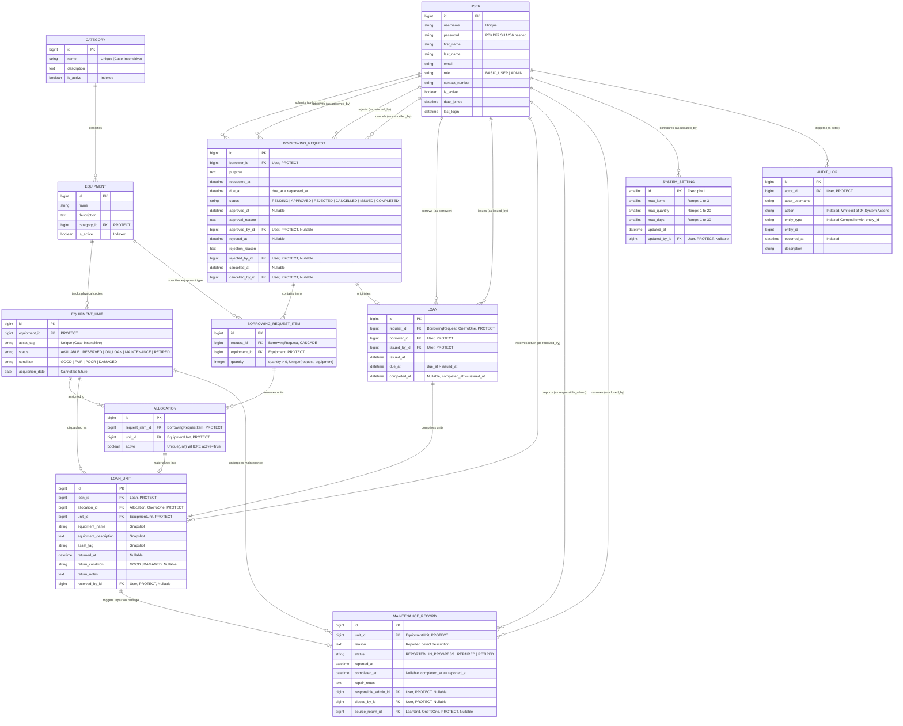

# Entity Relationship Diagram (ERD)

**Project:** Campus Equipment Borrowing and Inventory System
**Framework:** Django 6.1.2 / Python 3.13
**Database:** Relational Database (SQLite for development / PostgreSQL ready)
**Document Code:** ERD-IT401W-2026

---

## 1. Mermaid Entity Relationship Diagram

The diagram below maps all relational entities, primary keys (PK), foreign keys (FK), cardinalities, and attributes based on the verified Django ORM models and database migrations.

---

## 2. Cardinalities and Relational Logic

| Parent Entity | Relationship | Child Entity | Cardinality | Relational Rule / Deletion Behavior |
|---|:---:|---|:---:|---|
| `User` | 1 to Many | `BorrowingRequest` | $1 : N$ | `on_delete=models.PROTECT`. User accounts cannot be hard-deleted if borrowing history exists. |
| `User` | 1 to Many | `Loan` | $1 : N$ | `on_delete=models.PROTECT`. Protects historical auditability of issued loans. |
| `User` | 1 to Many | `AuditLog` | $1 : N$ | `on_delete=models.PROTECT`. Preserves immutable chain of custody for all audited operations. |
| `Category` | 1 to Many | `Equipment` | $1 : N$ | `on_delete=models.PROTECT`. Categories cannot be deleted if catalog equipment exists; archiving is enforced. |
| `Equipment` | 1 to Many | `EquipmentUnit` | $1 : N$ | `on_delete=models.PROTECT`. Catalog models cannot be removed if physical copies are registered. |
| `BorrowingRequest` | 1 to Many | `BorrowingRequestItem` | $1 : N$ | `on_delete=models.CASCADE`. Items are tightly coupled to the lifecycle of the request header. |
| `BorrowingRequest` | 1 to 1 | `Loan` | $1 : 1$ | `OneToOneField(on_delete=models.PROTECT)`. Exactly one issued loan can originate from an approved request. |
| `BorrowingRequestItem` | 1 to Many | `Allocation` | $1 : N$ | `on_delete=models.PROTECT`. Allocations tie specific physical units to requested item quantities. |
| `EquipmentUnit` | 1 to Many | `Allocation` | $1 : N$ | Filtered unique constraint: exactly **one active allocation** per physical unit at any instant. |
| `Loan` | 1 to Many | `LoanUnit` | $1 : N$ | `on_delete=models.PROTECT`. Every loan comprises 1 to $N$ individual unit dispatch records. |
| `Allocation` | 1 to 1 | `LoanUnit` | $1 : 1$ | `OneToOneField(on_delete=models.PROTECT)`. Links an approved reservation directly to its loan record. |
| `LoanUnit` | 1 to 1 | `MaintenanceRecord` | $0..1 : 1$ | `OneToOneField(null=True, blank=True)`. Intake link automatically populated when a unit is returned damaged. |
| `EquipmentUnit` | 1 to Many | `MaintenanceRecord` | $1 : N$ | Filtered unique constraint: at most **one active maintenance record** (`REPORTED` or `IN_PROGRESS`) per unit. |

---

## 3. Database Integrity & Concurrency Constraints

1. **Physical Unit Single-State Invariant:**
   Every physical unit belongs strictly to one state at any point in time: `AVAILABLE`, `RESERVED`, `ON_LOAN`, `MAINTENANCE`, or `RETIRED`.
2. **Atomic All-or-Nothing Unit Reservation:**
   During approval, `apps.borrowing.services.approve_request` validates that all requested quantities can be fulfilled simultaneously from available units. If even one unit cannot be reserved, the transaction aborts with zero side-effects.
3. **No Dual Active Allocations:**
   The database enforces `UniqueConstraint(fields=["unit"], condition=models.Q(active=True), name="borrowing_one_active_allocation")`.
4. **No Dual Active Issue:**
   The database enforces `UniqueConstraint(fields=["unit"], condition=models.Q(returned_at__isnull=True), name="loan_one_active_issue_per_unit")`.
5. **No Dual Active Maintenance:**
   The database enforces `UniqueConstraint(fields=["unit"], condition=models.Q(status__in=["REPORTED", "IN_PROGRESS"]), name="maintenance_one_active_per_unit")`.
6. **Unique Catalog Item Per Request:**
   The database enforces `UniqueConstraint(fields=["request", "equipment"], name="borrowing_one_equipment_per_request")`.
