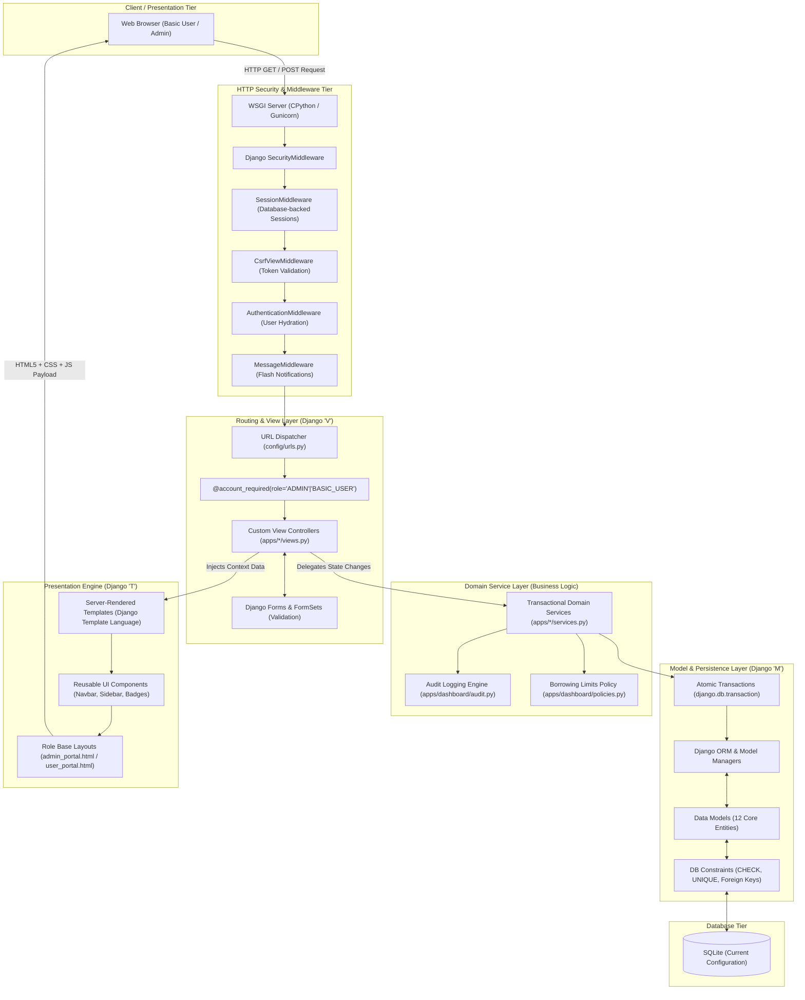

# System Architecture Documentation

**Course:** IT 401W Web Programming and Frameworks
**System:** Campus Equipment Borrowing and Inventory System
**Pattern:** Django Model-Template-View (MTV) Architecture
**Document Code:** ARCH-IT401W-2026

---

## 1. Architectural Overview & Django MTV Paradigm

The Campus Equipment Borrowing and Inventory System uses Django's **Model-Template-View (MTV)** pattern to separate persisted data, request handling and presentation. Security and institutional compliance still require appropriate implementation, configuration and review.

---

## 2. Core MTV Components in the Application

### 2.1 The Model Layer (`M`)
- **Location:** `apps/*/models.py`
- **Role:** Represents the data structure, encapsulates database tables, defines relationships, and enforces schema-level constraints.
- **Implementation Highlights:**
  - Standardized custom `User` inheriting from `AbstractUser`.
  - Historical references use protected relationships where deletion would remove transaction context; each migration specifies its own foreign-key deletion behavior.
  - Database-enforced business invariants utilizing `models.CheckConstraint` (e.g., `due_at > requested_at`, `quantity > 0`).
  - Conditional unique constraints preventing double reservations (`borrowing_one_active_allocation`) and concurrent unit checkouts (`loan_one_active_issue_per_unit`).

### 2.2 The Template Layer (`T`)
- **Location:** `templates/`
- **Role:** Presentation layer responsible for rendering HTML5, accessible components, and visual feedback without leaking backend logic.
- **Implementation Highlights:**
  - **Two Dedicated Portal Layouts:** `templates/dashboard/admin_portal.html` for administrators and `templates/dashboard/user_portal.html` for campus borrowers.
  - **Reusable Shared Components:** Modular includes under `templates/components/` for navbar, sidebar, pagination, tables, form errors, modals, and status badges.
  - **Accessibility support:** Text status labels, visible focus and responsive controls are present. The representative browser checks do not certify complete WCAG conformance.
  - **Strict Separation:** Templates contain zero SQL or mutation logic; they exclusively format context variables passed by the view controllers.

### 2.3 The View Layer (`V`)
- **Location:** `apps/*/views.py`
- **Role:** Handles incoming HTTP requests, performs role authorization, processes submitted forms, invokes service operations, and returns rendered HTTP responses.
- **Implementation Highlights:**
  - Clean separation between HTTP plumbing (`views.py`) and transactional business logic (`services.py`).
  - Route-level security through the custom `@account_required` decorator, enforcing active account status and strict role boundaries.
  - Owner-scoped query filtering: Basic Users can query only their own borrowing records (`borrower=request.user`).

---

## 3. Technology Stack Justification

| Technology | Selected Version | Architectural Justification |
|---|---|---|
| **Python** | `3.13` | Modern, performant runtime with advanced type hinting, enhanced memory management, and robust enterprise library support. |
| **Django** | `6.1.2` | High-level web framework providing built-in cryptographic authentication, automated ORM migrations, CSRF protection, and server-rendered templating. |
| **Relational Database** | SQLite in the current configuration | A local single-file database with tested transaction/constraint behavior. Other engines require separate configuration and concurrency validation. |
| **Vanilla JavaScript** | Modern ES6+ | Lightweight, zero-build-step client interactions (modal handling, sidebar toggling, printable slips) minimizing dependency vulnerabilities. |
| **Native CSS Components** | Modern CSS3 | Custom semantic design system with CSS custom properties (variables), responsive flexbox/grid layouts, and zero heavy external UI framework bloat. |

---

## 4. Architectural Options Comparison

In fulfillment of Course Outcome 2 (CO2) and the IT 401W project specifications, the engineering team evaluated two distinct architectural options before system implementation:

| Architectural Metric | Option A: Server-Rendered Django Monolithic MTV (Selected) | Option B: Decoupled Single-Page App (SPA) + Django REST Framework |
|---|---|---|
| **Architectural Complexity** | **Low to Moderate.** Single unified codebase, single deployment unit, native session-based authentication. | **High.** Dual repositories or complex monorepos, independent frontend build pipeline (Node.js/npm), separate API versioning. |
| **Security model** | Django provides session authentication, CSRF middleware and template escaping when used correctly. | A separate SPA/API can also use secure sessions and CSRF protection, but requires additional client/server configuration and deployment coordination. |
| **Data integrity and validation** | Django forms/services and database transactions run in one server-side workflow. | API requests still require authoritative server-side validation and transactions; the frontend must also handle asynchronous responses and errors. |
| **Admin Interface Compliance** | **100% Custom.** Custom Django views, templates, and forms cleanly deliver the required 75% custom admin functionality without prohibited packages. | **Complex Overhead.** Admin UI must be completely written from scratch in React/Vue components with redundant form validations. |
| **Operational trade-offs** | One application contains templates, workflows and services; no separate frontend build is needed. | Requires a frontend build and API integration; can be suitable where a separate client is an institutional requirement. |

### Conclusion & Architectural Recommendation
**Option A (Server-Rendered Django Monolithic MTV)** was chosen because it fits the project's custom Django template requirement and keeps the interface, forms and server-side workflows in one application. This choice does not by itself establish institutional security compliance or guarantee database locking; those depend on configuration and the selected database engine.

---

## 5. Security & Authorization Architecture

### 5.1 Dual-Role Isolation Model
The system enforces strictly two user levels: `BASIC_USER` and `ADMIN`.
- Public registration (`/register/`) explicitly binds new accounts to `role=User.Role.BASIC_USER`.
- Dynamic role escalation through form parameters, hidden inputs, or query strings is rejected at both the form clean layer and service layer (`apps.accounts.services.set_user_role`).
- Deactivated accounts (`is_active=False`) are blocked immediately from authenticating and are evicted upon their next request through session validation in `@account_required`.

### 5.2 Cryptographic Standards
- Passwords use Django's configured validators and password hashers. Stored hashes include the algorithm, work factor and salt; this document does not hardcode a version-specific iteration count.
- Opaque session keys use HttpOnly, SameSite cookies. The current configuration uses Django's database-backed session backend.
