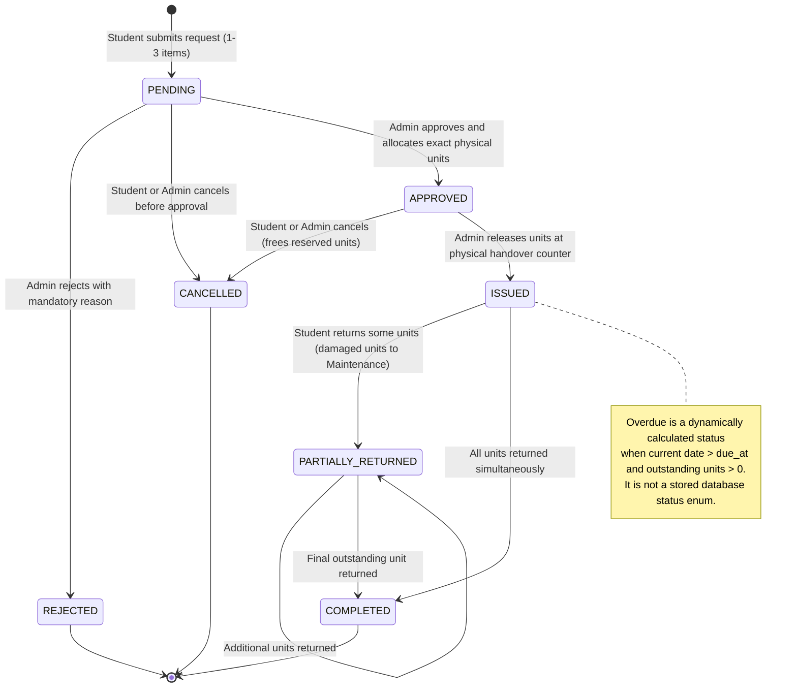
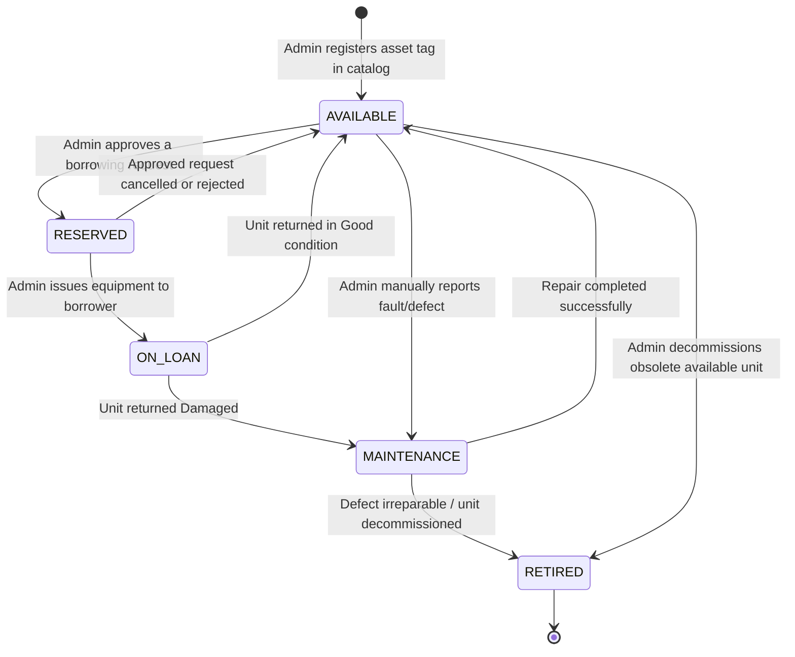
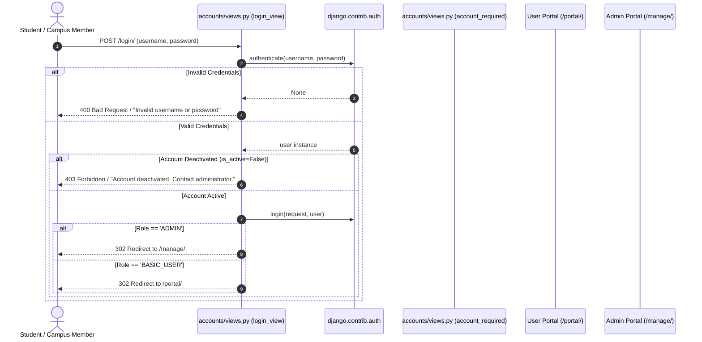
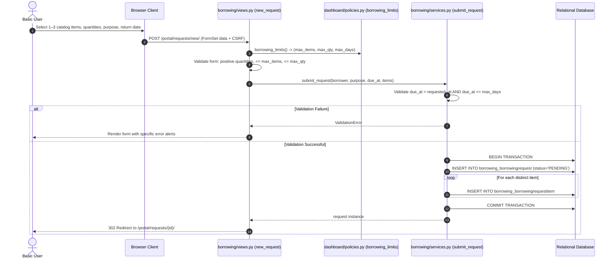
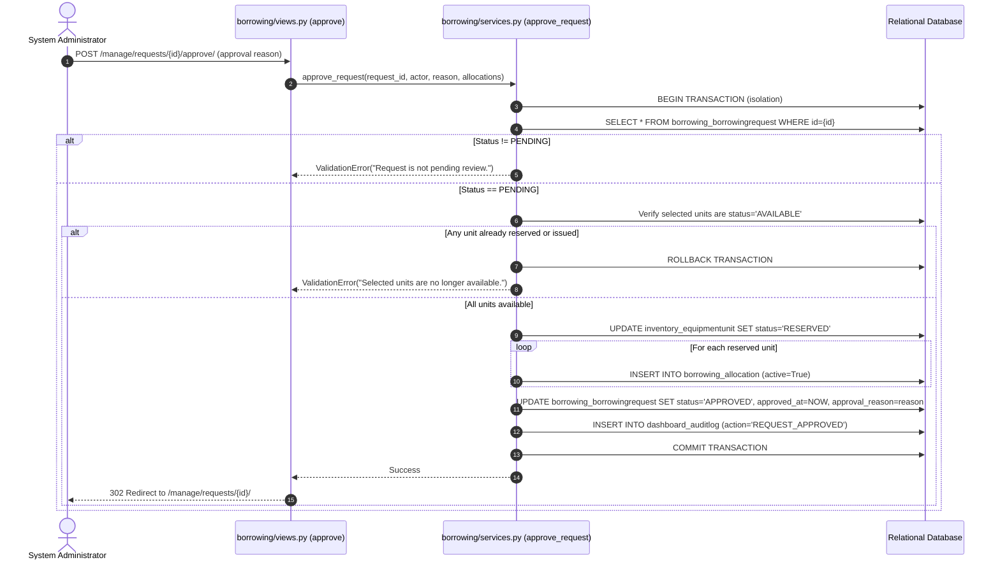
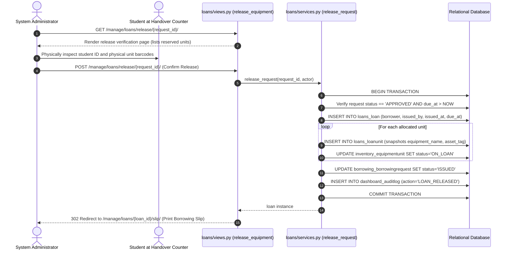
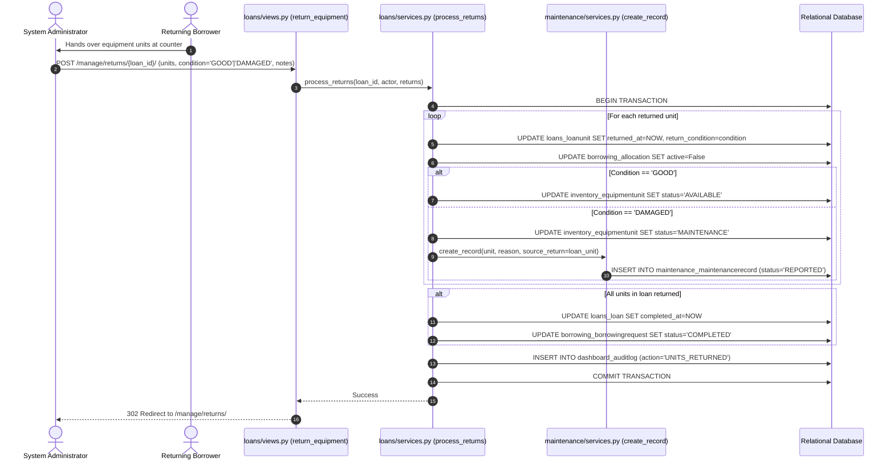
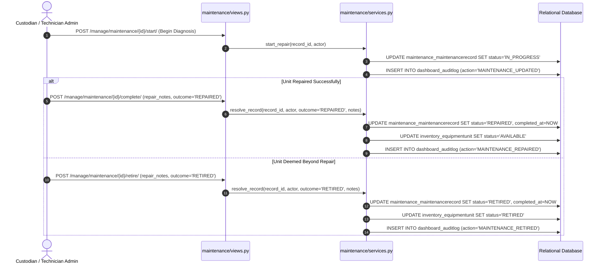

# System Workflows Documentation

**Course:** IT 401W Web Programming and Frameworks
**System:** Campus Equipment Borrowing and Inventory System
**Document Code:** WORKFLOWS-IT401W-2026

---

## 1. System Workflow State Machines

### 1.1 Borrowing Lifecycle State Machine

The borrowing lifecycle governs the progression of requests from initial student submission to complete physical unit return.

### 1.2 Physical Unit Inventory State Machine

Each physical `EquipmentUnit` maintains an invariant of exactly one mutually exclusive status at any instant.

---

## 2. Core Functional Workflows

### 2.1 User Registration, Authentication & Role Redirection

**Implementation Details:**
- Defined in `apps/accounts/views.py` and `apps/accounts/services.py`.
- Enforces session-level checks so that an account deactivated by an administrator is immediately locked out upon their next authenticated action.
- Self-promotion is structurally impossible during registration (`apps/accounts/forms.py` sets `role=User.Role.BASIC_USER`).

---

### 2.2 Borrowing Request Submission Workflow

**Implementation Details:**
- Hard-capped limits enforced via server-side settings (`SystemSetting` singleton). Default: max 3 distinct equipment types, max 3 units per type, max 7 calendar days loan duration.
- Atomic line-item validation: if row 3 of a 3-item request fails, zero records are saved.

---

### 2.3 Admin Review, Exact Unit Allocation & Approval Workflow

**Implementation Details:**
- Solves the concurrency race condition where two administrators attempt to allocate the final available unit. Database-level unique constraint `borrowing_one_active_allocation` combined with transactional locking ensures exactly one succeeds and the other receives a clean validation rejection.

---

### 2.4 Equipment Release & Handover Workflow

**Implementation Details:**
- Generates an official printable borrowing slip displaying borrower name, student identifier, asset tag numbers, issuance timestamp, return deadline, and signature acknowledgment lines.
- Automatically triggers browser `window.print()` upon user print initiation.

---

### 2.5 Partial & Full Equipment Return Workflow

**Implementation Details:**
- **Partial Return Support:** If a student borrows 3 units and returns 1, the loan remains active with 2 outstanding units. The borrowing slip and admin view reflect real-time outstanding tallies.
- **Immediate Defect Quarantine:** Any unit marked `DAMAGED` upon return is barred from returning to `AVAILABLE` status and is directly quarantined into a `REPORTED` maintenance ticket.

---

### 2.6 Maintenance Diagnostics, Repair & Retirement Workflow

**Implementation Details:**
- Maintenance tickets require detailed problem documentation upon intake and resolution notes upon closing.
- Units undergoing maintenance cannot be allocated, approved, or issued.
- Retiring a unit permanently excludes it from the lendable inventory pool while preserving its complete historical records.
